# sql-analytics-project


SQL analytics on the [Chinook](https://github.com/lerocha/chinook-database) sample database, a
digital music store with 11 tables, 59 customers, 412 invoices and about 3,500 tracks. The repo
starts with the groundwork that every analysis depends on: loading the data safely, understanding
its schema, and profiling its quality. Business questions in plain SQL build on top of it.

## Setup

```bash
pip install pytest          # only for the tests; the tooling uses the standard library
PYTHONPATH=src python -m sqlproject check    # integrity check: file is sound, every foreign key resolves
PYTHONPATH=src python -m sqlproject docs     # regenerate docs/schema.md and docs/data_profile.md
PYTHONPATH=src pytest
```

The database ships in `data/Chinook.sqlite` (MIT licensed, see [`data/NOTICE.md`](data/NOTICE.md)).

## Schema

[Full diagram and column list](docs/schema.md) (Mermaid, rendered by GitHub), generated from the
database itself rather than drawn by hand, so it cannot drift from the data:



`||--o{` means every child row has exactly one parent; `|o--o{` means the parent is optional. For
example `Track.AlbumId` is nullable, while `Invoice.CustomerId` is not.

## Data profile

[`docs/data_profile.md`](docs/data_profile.md) lists row counts and which columns contain NULLs.
Things worth knowing before writing queries:

- `Customer.Company` is NULL for 49 of 59 customers, so a join or filter on it silently drops most rows.
- `Invoice.BillingState` is NULL for 202 of 412 invoices (countries without states), so grouping by state needs `COALESCE`.
- `Track.Composer` is NULL for 977 of 3,503 tracks.
- `Employee.ReportsTo` has exactly one NULL: the top of the reporting tree.

## Business questions

Ten questions answered with joins and aggregations, one `.sql` file each in [`queries/`](queries/),
with results in [`results/`](results/) and a readable write-up in
[`docs/business_questions.md`](docs/business_questions.md):

| # | Question | SQL techniques |
|---|---|---|
| 1 | Which countries generate the most revenue? | GROUP BY, SUM, AVG |
| 2 | Who are the top 10 customers? | INNER JOIN, GROUP BY |
| 3 | Which genres earn the most? | 3-table join, LEFT JOIN, COALESCE |
| 4 | Which artists bring in the most revenue? | 4-table join chain |
| 5 | How does revenue move month by month? | strftime date bucketing |
| 6 | How much revenue does each support rep's customer base generate? | LEFT JOINs that keep reps with no customers |
| 7 | How many tracks have never been bought, by genre? | Anti-join (LEFT JOIN ... IS NULL) |
| 8 | How many customers placed 1, 2, 3... invoices? | Aggregate of an aggregate |
| 9 | How big is each playlist? | Link-table join, unit conversion |
| 10 | Who reports to whom? | Self-join |

Some of what the results show (all from `results/`):

- The USA is the top market with 91 of 412 invoices and $523.06 of $2,328.60 in revenue (22.5%); Canada is second at $303.96.
- Rock is the top genre at $826.65, about 35.5% of revenue; Iron Maiden is the top artist at $138.60.
- 1,519 of 3,503 tracks (43%) have never been bought.
- Purchasing is almost uniform: 58 of 59 customers placed exactly 7 invoices and one placed 6. That points to generated sample data, so patterns like "repeat buyers" cannot be drawn from it.
- Two playlists are both named "Music" (ids 1 and 8) with identical sizes, a duplicate worth cleaning in a real system.

### How the results are checked

SQL that runs is not necessarily SQL that is right. `tests/test_queries.py` recomputes every answer
in plain Python (dictionaries and loops over the raw tables) and compares. It also reconciles
totals: revenue from `Invoice.Total` equals revenue rebuilt from `InvoiceLine` ($2,328.60), and the
join-heavy questions (genres, artists, reps, months) each sum back to that same total, which proves
the joins lose no rows. Another test fails if the committed `results/` or `docs/` are out of date.

```bash
PYTHONPATH=src python -m sqlproject report   # rerun all queries, rewrite results/ and docs/business_questions.md
```

## Code

| Module | Purpose |
|---|---|
| `sqlproject.db` | Read-only connection, introspection of tables, columns and foreign keys, row and NULL counts, integrity check |
| `sqlproject.diagram` | Mermaid ER diagram and data-profile Markdown generated from that introspection |
| `sqlproject.runner` | Loads `queries/*.sql`, runs them read-only, writes CSV results and the Markdown report |

Design notes:

- **Read-only by default.** `connect()` opens the file with `mode=ro`, so an analysis query can never change the source data (a test tries to `DELETE` and expects failure).
- **Table names are validated against the database** before being placed in SQL, because identifiers cannot be bound as parameters.
- **Generated docs are tested.** One test fails if `docs/` is out of date with the database.

## Next

CTEs and window functions for ranking and running totals, a query-plan comparison with and without an index, and parameterized queries from Python.
