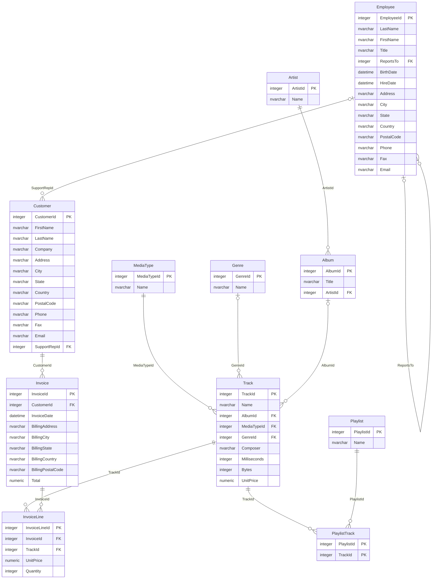

# Schema

Generated from the database by `python -m sqlproject docs`; do not edit by hand.

`||--o{` means one parent row has many child rows and every child must have a parent; `|o--o{` means the parent is optional.
